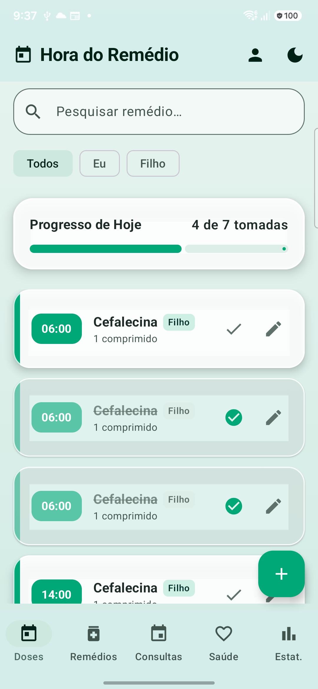
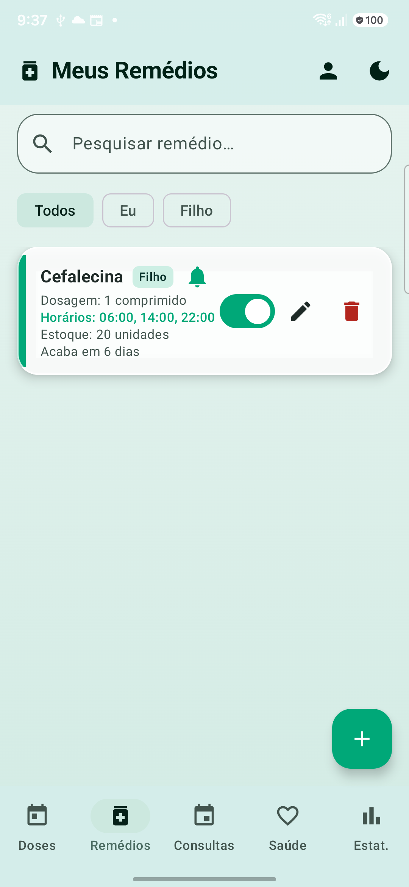
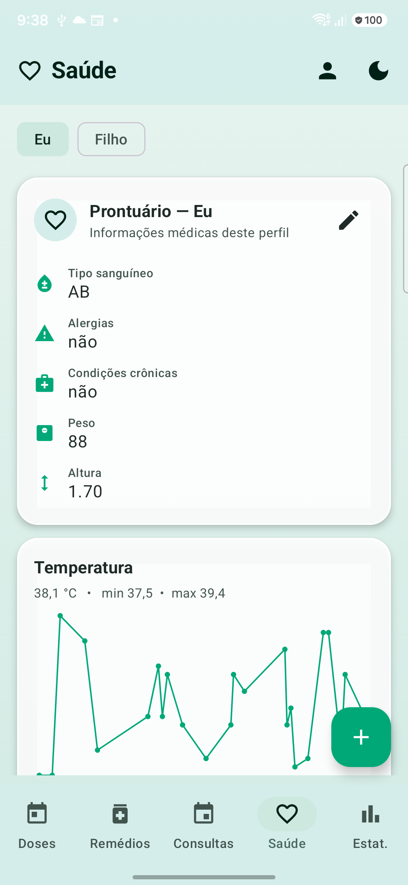
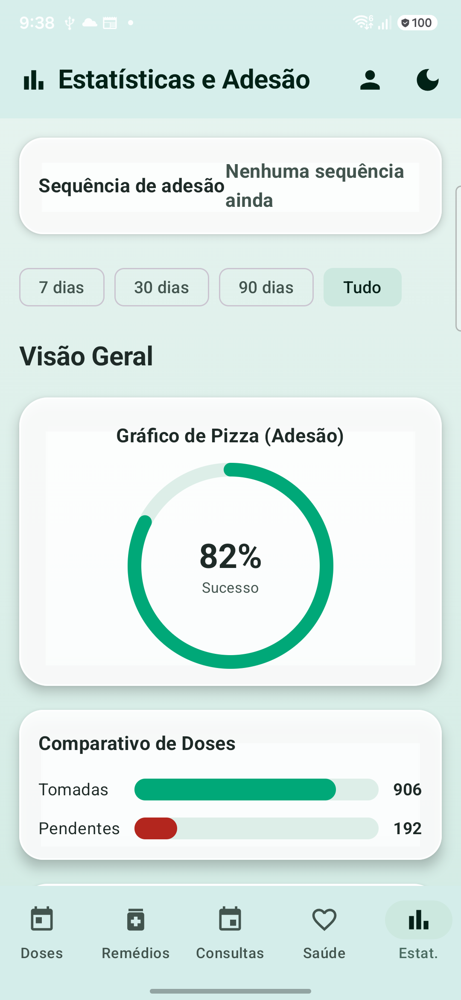
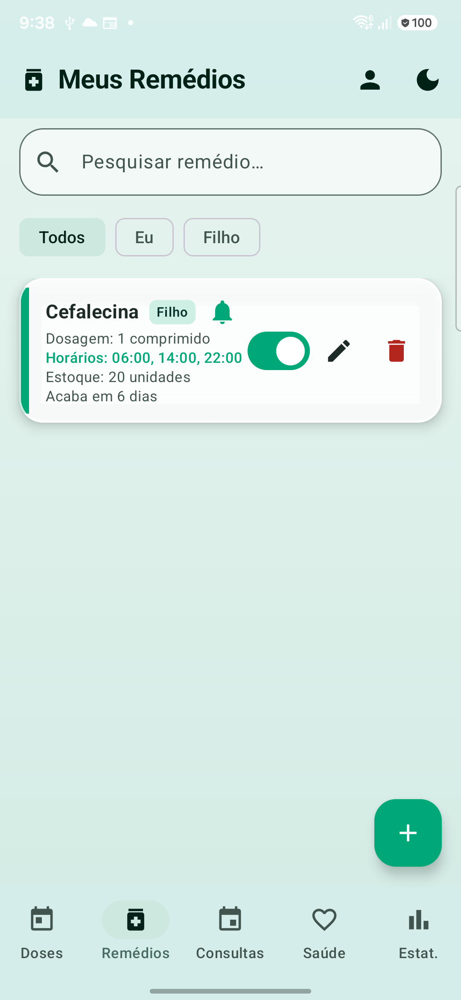
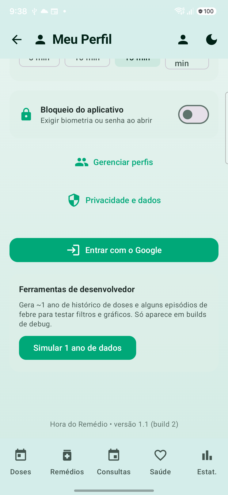

# 💊 Hora do Remédio

[](https://kotlinlang.org)
[](https://developer.android.com/jetpack/compose)
[](https://developer.android.com/training/data-storage/room)
[](https://developer.android.com)
[](#)

Um aplicativo Android moderno para **lembretes de medicamentos**, organização por
**perfis** (você, mãe, pai, pet…) e acompanhamento da saúde com **prontuário**,
**diário de sintomas** e **estatísticas de adesão**. Offline-first e com foco em
privacidade: **todos os dados ficam apenas no seu aparelho**.

---

## 📱 Telas

<table>
  <tr>
    <td align="center"><br/><sub><b>Doses de hoje</b></sub></td>
    <td align="center"><br/><sub><b>Meus remédios</b></sub></td>
    <td align="center"><br/><sub><b>Saúde (prontuário + gráficos)</b></sub></td>
  </tr>
  <tr>
    <td align="center"><br/><sub><b>Estatísticas e adesão</b></sub></td>
    <td align="center"><br/><sub><b>Detalhe do medicamento</b></sub></td>
    <td align="center"><br/><sub><b>Perfil e ajustes</b></sub></td>
  </tr>
</table>

---

## ✨ Funcionalidades

### ⏰ Lembretes confiáveis
- Alarmes **exatos** (`setAlarmClock` + `AlarmManager`) que resistem ao modo Doze.
- **Reagendamento automático** após reiniciar o aparelho, mudança de fuso/hora ou atualização do app (`WorkManager` + `BroadcastReceiver`).
- Notificações com ações **Tomar agora** e **Adiar** (tempo configurável: 5/10/15/30 min), com **som/vibração por medicamento**.
- Fluxo guiado de permissões (notificações, alarme exato e otimização de bateria).

### 💊 Medicamentos e perfis
- Cadastro com **catálogo/autocomplete**, dosagem, horários, estoque e **previsão de término** ("acaba em X dias", "recompra sugerida").
- **Perfis personalizáveis** (adicionar, renomear e remover) — renomear **atualiza em cascata** medicamentos, prontuário e diário.
- Suporte a **vários perfis** (ex.: Eu, Mãe, Pai, Filho, Pet) com filtro por perfil.

### 🩺 Saúde
- **Prontuário por perfil**: tipo sanguíneo, alergias, condições crônicas, peso, altura, contato de emergência e observações.
- **Diário de saúde** com **timeline unificada** que junta automaticamente as **tomadas de remédio** + os eventos registrados (sintomas, febre, pressão, notas).
- **Anexo de foto** nos registros e **gráfico de temperatura**.
- **Alerta de alergia** ao cadastrar um medicamento compatível com a alergia do perfil.

### 📊 Estatísticas e relatórios
- Adesão com **filtro por período** (7/30/90 dias ou tudo), **por perfil** e **por medicamento**.
- **Sequência (streak)** de dias com adesão completa.
- Exportação de **relatório CSV** e **PDF** (com o prontuário incluído).

### 🔒 Privacidade e extras
- **Bloqueio do app** por biometria/senha.
- **Backup e restauração** (JSON) e **exclusão total de dados**.
- **Política de privacidade** integrada.
- **Widget** de próxima dose e base de **assinatura (Google Play Billing)**.
- Tema **claro/escuro** e suporte a **Português e Inglês**.

---

## 🛠️ Tecnologias

| Camada | Stack |
|--------|-------|
| Linguagem | **Kotlin** |
| UI | **Jetpack Compose** + Material 3 |
| Navegação | Navigation Compose |
| Persistência | **Room** (migrações versionadas + testes) |
| Assíncrono | Coroutines + Flow |
| Trabalho em background | **WorkManager** + AlarmManager |
| Preferências | DataStore |
| Imagens | Coil |
| Segurança | AndroidX Biometric |
| Widgets | Glance |
| Monetização | Google Play Billing |
| Build | Gradle (Kotlin DSL) + version Catalog |

**minSdk 26 · targetSdk 37**

---

## 🏛️ Arquitetura

Arquitetura em camadas (MVVM + Repository), priorizando testabilidade:

```
app/
├─ data/        Entidades Room, DAOs, repositórios (Backup, Billing, Settings, Profile…)
├─ domain/      Regras de negócio puras e testáveis
│               (DoseAdherence, AdherenceStreak, InventoryForecast,
│                AllergyMatcher, HealthMetrics, ReportCsv, PremiumLimits…)
├─ notifications/ Alarmes, notification channels, workers e receivers
├─ ui/          Telas Compose, ViewModel (estado único), diálogos e temas
└─ widget/      Widget de próxima dose (Glance)
```

- **Estado único** exposto por `MedicationViewModel` (combina múltiplos `Flow`).
- **Migrações do Room testadas** (v3→v8) com `MigrationTestHelper`.
- **Tokens de design** centralizados (cores de superfície, bordas, raios).

---

## 🚀 Como compilar

Pré-requisitos: **JDK 17+** e **Android SDK**.

```bash
# Build de debug
./gradlew assembleDebug

# Instalar no dispositivo conectado
./gradlew installDebug

# Testes unitários + lint
./gradlew testDebugUnitTest lintDebug

# Testes instrumentados (migrações) — requer dispositivo/emulador
./gradlew connectedDebugAndroidTest
```

### Release assinado
Crie um `keystore.properties` na raiz (não versionado):

```properties
storeFile=keystore/aprobile-release.jks
storePassword=****
keyAlias=aprobile
keyPassword=****
```

```bash
./gradlew assembleRelease   # gera app/build/outputs/apk/release/app-release.apk
```

---

## 🧪 Ferramenta de simulação (debug)

Em builds de **debug**, o Perfil inclui **"Simular 1 ano de dados"**, que gera
~1 ano de histórico de doses e episódios de febre para testar os filtros de
período, os gráficos e as estatísticas. Não aparece em versão de release.

---

## 🔐 Privacidade

O Hora do Remédio é **offline-first**: nenhum dado é enviado para servidores.
Tudo é armazenado localmente (Room + DataStore). Você pode **exportar**, **importar**
ou **excluir** seus dados a qualquer momento na tela *Privacidade e dados*.

---

## 📄 Licença

© 2026 — Hora do Remédio. Todos os direitos reservados.
